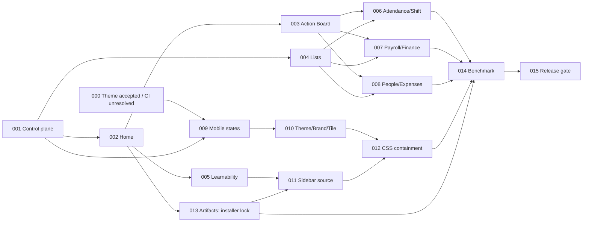

# UX campaign master plan

TASK-ID: TXUX-260930-001. Accepted shared base: `feature/hrms-v16-hr-only` / `1a194240b7312609f0dbcf4195558a54bddcca8c` (merged PR #52).

## Immutable design contract

Native Employee, Checkin, Attendance Request/Attendance, Leave, Shift, SSA/Salary Structure, payroll and accounting documents remain the authorities. No second ledger, custom approval/task-state database, UI authorization or frontend payroll/legal computation. Existing server scope, maker/checker, idempotency and historical safeguards survive every UI change. No guessed legal rates or company wage defaults. No real business mutation, production change, core modification or new Page without an explicitly approved necessity demonstration.

Decision order: installed native behavior → native metadata → supported hook/standard extension → small app adapter → explicitly authorized custom UI only if the preceding options fail. Native Workspace Sidebar is the foundation. The existing Action Board remains a read-only adapter over existing inspectors/reports; presentation work must not copy their calculations.

## Permanent registry

IDs `TXUX-260930-000` through `015` are reserved with the meanings below. Primary/patch/metadata IDs are never reused. Abbreviated dependencies in the table always mean the full campaign ID. “Shared” means a flat branch from the latest independently accepted shared base. “Dependency” means stack only if it uses actual unmerged code, record the exact dependency head, and avoid a giant linear stack.

| ID / name / type | Purpose | Dependencies / base strategy | Ownership / primary agent | Parallel-safe with / blocks | Acceptance gate / expected PR scope / rollback |
| --- | --- | --- | --- | --- | --- |
| 000 Native page dark theme / implementation | Correct two existing field-page card surfaces | Shared exact release base; existing PR #53 | Existing GLOBAL UI/MOBILE intersection; independent reviewer | 001 audit; blocks final 009/010 theme integration | Accepted implementation, open draft, remote CI unresolved. Scoped native tokens; revert CSS/test commit only. |
| 001 Control plane / audit | Permanent IDs, inventory, measured baseline, routes, locks | Shared exact release base | Six authorized documentation files; independent reviewer | 000 and nonconflicting research; enables 002/004/009/013 research | Source/GitHub audit, measured journeys with limitations, scope/link checks; docs-only PR; revert docs. |
| 002 Home convergence / implementation | One obvious primary entry for ordinary work; reduce redundant Home choices | 001; Shared | WORKSPACE; Luna | 004, 009; 013 research only; blocks 003/005 and installer cleanup | Persona Home parity and native target visibility, no lost needed route; Home metadata/tests only; restore prior metadata via standard convergence. |
| 003 Compact Action Board / implementation | Exception-first presentation and clear recovery, preserve adapters | 001, 002; Shared unless Home code is required | ACTION BOARD; Luna + independent review | 004/005/009/013 subject to locks; blocks recovery integration and 014 | Preserve source/scope; compact categories/severity, empty/error honesty; reproduce modal leakage. Adapter/UI/tests only; revert adapter/presentation. |
| 004 Native List View / cleanup | Compare date controls, native quick/saved filters and scoped Link UX | 001; Shared | LIST; Gemini | 002, 009, 003, domain tasks that do not touch list settings; blocks 006/007/008 acceptance | Desktop + phone evidence; preserve negative scope tests and datetime context; one list family; revert customization. |
| 005 Native learnability / implementation | Guided first use through native onboarding/form-tour/help mechanisms | 001, 002; Shared | WORKSPACE metadata (reserve any new onboarding files); Gemini | 003, 004, 009; serial with 013 installer edits; blocks 011 acceptance | Native completion/role filtering, no new task ledger or manufactured config; metadata/guidance/tests; remove guidance metadata. |
| 006 Attendance/Shift recovery / implementation | Explain evidence, draft/submit state and canonical next step | 001, 003, 004; integrate 002 route decisions | ATTENDANCE/SHIFT UI; Luna | 007/008 if no shared Calendar/hook/test edits; blocks 014 | Preview/confirm/partial/retry and independent approval preserved; existing reports/forms only; revert UI. |
| 007 Payroll/Finance recovery / implementation | Precise blocker-to-native-record guidance and money-state explanation | 001, 003, 004; integrate 002 routes | PAYROLL/FINANCE UI; Luna + independent review | 006/008 subject to locks; blocks 014 | No copied money calculation, salary disclosure, mutation/permission changes; existing UI adapters/tests; revert UI. |
| 008 Employee/joiner/exit/expense recovery / implementation | Reuse Employee readiness and native lifecycle/expense forms | 001, 003, 004; integrate 002 routes | EMPLOYEE/LIFECYCLE/EXPENSE UI; Gemini | 006/007 with Calendar boundary; blocks 014 | Identity, readiness, lifecycle/history/maker-checker remain native; existing UI only; revert UI. |
| 009 Mobile state clarity / implementation | Distinguish local saved, server accepted, pending review and rejected evidence | 001; accept 000 theme evidence before final integration; Shared | MOBILE; Luna + independent review | 002/004/003; blocks 010/014 | State fixtures/browser offline tests; self-service, quarantine/private media/review/queue unchanged; no new Page; revert labels/UI. |
| 010 Theme/branding/app tile / cleanup | Prefer native settings/theme routing; reduce DOM-specific custom behavior | 001, 000, 009; Shared unless real code dependency | GLOBAL UI; Gemini | 011/domain UI; blocks 012 | Light/dark, desktop/phone, native theme persistence, tile behavior; global family only; restore narrow adapters. |
| 011 Sidebar source ownership / cleanup | Prove standard app-level Sidebar JSON migration vs installer ownership | 001, 002, 005; serialize with 013 | WORKSPACE; Gemini + independent review | 010/domain UI; blocks 012/014 | Installed export/sync proof, neutral install + persona/stored customizations; no core edit; metadata rollback after verified backup. |
| 012 Global CSS containment / audit+cleanup | Measure shell width/sidebar/gutters before removing risky selectors | 001, 010, 011 | GLOBAL UI; independent reviewer, Gemini patches | Domain UI/docs; blocks 014 | Viewport/overflow/focus/native sidebar regression; no new theme system; bounded CSS/tests; revert CSS. |
| 013 Artifact cleanup / cleanup | Remove only proven unused charts/cards/legacy UI artifacts | 001, **002 lock release**; Shared | ARTIFACT SOURCE + WORKSPACE; Gemini | 004/009/003; research can precede 002; blocks 014 | Repository + stored-reference audit, permissions, installer/fresh-install parity; artifact metadata/tests only; restore source/metadata. |
| 014 Accessibility/resilience/benchmark / validation | Repeat journeys and real-operator protocol, independent final UX audit | 002–013 accepted; Shared integrated head | Independent reviewer; reserve patches separately | Docs/release prep; blocks 015 | Compare same scenarios/starts/devices; keyboard/contrast/overflow/failure; no speculative redesign; evidence-only or separate patch IDs. |
| 015 UX release gate / validation | Prove integrated source/dependency/CI/UAT truth | 000–014; final integrated accepted head | Independent reviewer; documentation | None dependent | Exact PR graph, local/static/browser evidence, honest remote/device/staff gates; no production cutover; docs rollback. |

Primary agent labels are allocation recommendations (Luna/Gemini/independent reviewer), not a request to spawn agents during 001. Reviewers must inspect final heads independently.

## Dependency graph and waves

| Wave | Work | Lock caveat |
| --- | --- | --- |
| 0 | 000 accepted implementation + 001 | #53 remains separate; do not cherry-pick or assume merged. |
| A | 002 + 004 + 009 | Three independent runtime locks. 013 can audit references additionally, but installer edits wait for 002. |
| B | 003 + 005; 013 after Workspace release | 005 and 013 share installer/metadata: serialize their edits. |
| C | 006 + 007 + 008 | At most three owners; Calendar/hooks/translations/test conflicts require reservation. |
| D | 010 + 011, then 012 | 011 follows 005/013 Workspace completion; 012 follows both shell/theme and sidebar evidence. |
| E | 014 then 015 | Final integrated benchmark and release disposition. |

Changes to the proposed graph: 013 installer cleanup cannot safely run beside 002/005 because all own `install.py`; its research can. 012 must consume 011's actual sidebar evidence as well as 010. No dependency requires every domain PR to stack sequentially. Acceptance dependencies are not automatically code ancestry dependencies.

## Review / merge protocol

Agents open DRAFT PRs and never merge, close, retarget or force-push. Independent reviewer validates exact base/head, files/locks, native-first decision, behavior, negative permission/maker-checker/retry evidence where relevant, browser evidence and unresolved UAT. Remote failing/unexecuted checks remain separate from local acceptance. Only the authorized human decides integration order and when the shared accepted base advances. Recheck affected sibling diffs after integration; do not rewrite another active branch.

Targets and baseline limits are in BASELINE. Required previews, confirmations and independent approvals are safety actions, not navigation waste. No future task may remove them to lower a click count.
